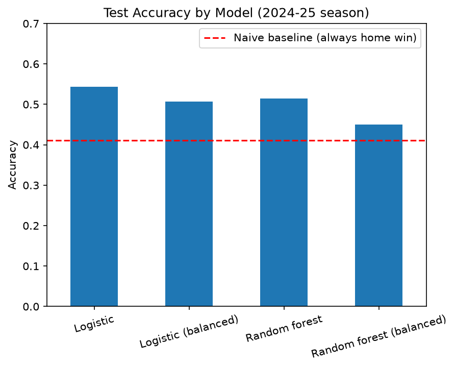

# Premier League Match Predictor
Predicts the outcome (home/draw/away) and each team's expected goals (xG) for Premier League matches, using information known only before kick-off.

## Overview 

- **Training data:** 2020-21 to 2023-24 seasons (1,439 matches)
- **Test data:** 2024-25 season (375 matches), held out from training
- **Classification:** logistic regression and random forest predict home win / draw / away win
- **Regression:** linear regression and random forest predict home and away xG

## Results

**Match outcome (2024-25 test season)**

| Model | Accuracy | Macro F1 | Draw recall |
|---|---|---|---|
| Naive baseline (always predict home win) | 41.1% | - | - |
| Logistic regression | **54.4%** | 0.41 | 0.00 |
| Logistic regression (class-balanced) | 50.7% | **0.46** | 0.18 |
| Random forest | 51.5% | 0.38 | 0.00 |
| Random forest (class-balanced) | 45.1% | 0.41 | 0.13 |
##



*Test accuracy for each model. The dashed red line is the naive baseline (always predicting a home win). All four models beat it, with logistic regression being the highest.*

**Predicted xG per team (2024-25 test season)**

| Target | Baseline RMSE | Linear regression RMSE (R²) | Random forest RMSE (R²) |
|---|---|---|---|
| Home xG | 0.945 | 0.866 (0.160) | **0.857** (0.176) |
| Away xG | 0.945 | **0.821** (0.220) | 0.829 (0.205) |

*The xG models use the 18 pre-match features plus Bet365 pre-match odds. The baseline always predicts the training average.*
##
**Takeaways**

- The best classifier model beats the naive baseline by about 13 percentage points (54.4% vs 41.1%).
- Logistic regression beat random forest in every comparison, tuned or not. The relationship between recent form and results is simple, so the logistic regression fits better on this dataset
- Hyperparameter tuning (time-ordered cross-validation) changed results by about 1 point or less, so the untuned models are the final ones.
- Draws are a limitation of the models. The default models almost never predict a draw. The class-balanced model does, but when it predicts a draw it is right about as often as the base rate (24%).
- The xG models beat a naive average baseline, but explain only a modest share of single-match variation (R² of about 0.16 to 0.18 home, 0.21 to 0.22 away). Both models perform alike.


## Data

| Source | Used for |
|---|---|
| [football-data.co.uk](https://www.football-data.co.uk/) | Match results, statistics, and Bet365 odds for six seasons (2020-21 to 2025-26) |
|[EPL Expected Goals stats (2014-2025)](https://www.kaggle.com/datasets/redaali009/epl-expected-goals-stats-2014-2025) by redaali009 on Kaggle | Per-match xG for both teams, available up to 2025-12-02 |


**Cleaning and merging:**

- Combined the six season files into one table.
- Standardized team names so the sources match
- Removed duplicate rows in the xG file, then merged on date, home team, and away team.
- Dropped matches after 2025-12-02, since xG data is not available for them.
- 1,942 matches remain after cleaning. 128 are from the partial 2025-26 season and are not used for training or testing.

## Final Output: Outcome and xG Predictions

For each match the model gives outcome probabilities, a predicted xG for each team, and its pick. Below are the first three matches of the 2024-25 test set.

```text
Manchester United vs Fulham  (2024-08-16)
  Home win: 51% | Draw: 25% | Away win: 25%
  Predicted xG: 1.98 - 1.16
  Predicted: Manchester United win  |  Actual: Manchester United win  (correct)
  Actual xG: 2.04 - 0.42

Nottingham Forest vs Bournemouth  (2024-08-17)
  Home win: 45% | Draw: 25% | Away win: 30%
  Predicted xG: 1.67 - 1.31
  Predicted: Nottingham Forest win  |  Actual: Draw  (incorrect)
  Actual xG: 1.24 - 1.91

Newcastle United vs Southampton  (2024-08-17)
  Home win: 88% | Draw: 8% | Away win: 4%
  Predicted xG: 2.72 - 0.95
  Predicted: Newcastle United win  |  Actual: Newcastle United win  (correct)
  Actual xG: 0.43 - 1.95
```
- The "Actual" lines are for comparision and are not inputs
- The outcome probabilities come from the logistic regression, whereas the predicted xG comes from the linear regression models.
- Newcastle vs Southampton shows how noisy single matches can be. Newcastle won the match despite heavily losing out on xG.


## Method 
**1. Features**

Same-match statistics such as goals, xG, and shots are only known after the match, so they are never used as inputs. Instead, each team's recent performance is summarized with rolling averages over its previous 5 matches. The value is shifted by one game so the current match is excluded.

18 features per match (same 9 for home/away): 

| Feature (per team) | What it is |
|---|---|
| `Form_Points` | Points earned in the last 5 matches |
| `Form_GoalsFor` | Average goals scored, last 5 matches |
| `Form_GoalsAgainst` | Average goals conceded, last 5 matches |
| `Form_xGFor` | Average xG created, last 5 matches |
| `Form_xGAgainst` | Average xG conceded, last 5 matches |
| `Form_ShotsOnTargetFor` | Average shots on target taken, last 5 matches |
| `Form_ShotsOnTargetAgainst` | Average shots on target faced, last 5 matches |
| `H2H_Avg_Points` | Average points against this opponent in all earlier meetings (a neutral 1.0 if the teams have not met in the data) |
| `IsNewlyPromoted` | 1 if the team was promoted this season, otherwise 0 |

In the notebook these appear with `Home_` and `Away_` prefixes, for example `Home_Form_xGFor`.

The xG models use these 18 features plus three more: Bet365's pre-match odds converted to implied probabilities for a home win, draw, and away win. The probabilities are normalized to sum to 1, which removes the bookmaker's margin. Odds are set before kick-off, so they are not leakage. The outcome classification model does not use them.


Each team's rolling features are computed from team-level rows first, then merged back so every match has home and away features side by side. Early matches without 5 prior games were dropped.

**2. Chronological split** 

Train on 2020-21 to 2023-24, test on 2024-25. A random split would leak future information into training, since the features depend on match order.

**3. Feature selection**

Corners, yellow cards, red cards, and total shots were also engineered and tested. Extra feature groups were compared using time-ordered cross-validation on the training data only. Shots on target was the only group that improved results consistently, and adding every extra feature performed the worst. The final set is 18 features.

**4. Models**

- Logistic regression (features scaled, scaler fit on training data only) and random forest, each in a default and a class-balanced version
- Linear regression and random forest regressors for home xG and away xG
- Hyperparameter tuning with `GridSearchCV` and `TimeSeriesSplit`

**5. Evaluation**

Accuracy against a naive baseline, confusion matrix, and per-class precision and recall (not accuracy alone, since a model can score well while ignoring draws).

## Limitations

- **Draws:** The model can't reliably tell which matches will end level. When the balanced model predicts a draw, it is right about as often as chance (24%).
- **One test season:** 375 matches means accuracy naturally varies by roughly 2.5 points, so small differences between models are not meaningful.
- **Test set reuse:** The 2024-25 season was used to compare models, so the reported scores are slightly optimistic.
- **Limited information:** The model has no injuries, lineups, transfers, or manager changes.
- **Short history:** Only four training seasons, and team quality drifts between seasons.
- **Sparse head-to-head data:** Many pairings have no previous meeting in the data and use a neutral value.
- **Modest xG fit:** The regression beats the baseline, but single-match xG depends on game events that pre-match statistics cannot see.

## How to Run

```bash
git clone https://github.com/pasoon7/soccer-predictor.git
cd soccer-predictor
python -m venv venv
source venv/Scripts/activate     
pip install -r requirements.txt
```

Open `Premier_League_Predictor.ipynb` in VS Code or Jupyter and run all cells. The data files are in `data/`. Tested with Python 3.12.

## Project Structure

```
soccer-predictor/
├── data/               # season CSVs and xG data
├── images/             # charts 
├── models/             # saved scaler and trained models (joblib)
├── Premier_League_Predictor.ipynb      # full analysis
├── requirements.txt
├── LICENSE
└── README.md
```
## Future Work

- Streamlit app for interactive predictions
- Live predictions for upcoming fixtures with an automatically updated accuracy tracker
- Improve on the current 54.4% outcome accuracy: add earlier season data, injury and lineup data, team ratings and more.
- Probability calibration and weighting recent seasons more heavily

## Acknowledgements

Match data and Bet365 odds from football-data.co.uk. xG data from the "EPL Expected Goals stats (2014-2025)" dataset by redaali009 on Kaggle.